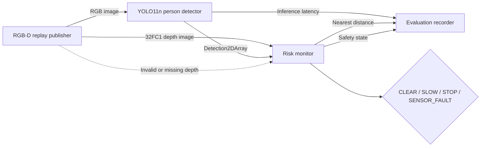

# Fault-Aware Human Proximity Estimation with ROS 2

A simulation-only ROS 2 perception project that combines pretrained person detection with aligned depth data to estimate human proximity and produce fail-safe safety states.

The system uses YOLO11n through ONNX Runtime for RGB person detection, extracts the median valid depth inside each detected bounding box, and publishes one of four states:

- `CLEAR`
- `SLOW`
- `STOP`
- `SENSOR_FAULT`

## Why this project exists

Robots operating near people require more than object detection. They must combine perception sources, handle invalid sensor data, and expose failures explicitly instead of silently making unsafe decisions.

This project explores that problem through a small, reproducible ROS 2 pipeline running entirely in simulation on a CPU-only ARM64 virtual machine.

## Architecture



## Main components

| Node | Responsibility |
|---|---|
| `rgbd_replay_publisher` | Publishes a repeatable RGB image and aligned synthetic depth map |
| `ai_person_detector` | Runs YOLO11n ONNX inference with ONNX Runtime |
| `risk_monitor` | Fuses detections and depth and determines the safety state |
| `evaluation_recorder` | Records detection, distance, state and latency statistics |
| `scenario_publisher` | Publishes the earlier geometric test scenario |
| `mock_person_detector` | Provides deterministic bounding boxes for initial integration tests |

## Safety policy

Default thresholds are:

| Condition | State |
|---|---|
| Distance ≤ 1.0 m | `STOP` |
| 1.0 m < distance ≤ 3.0 m | `SLOW` |
| Distance > 3.0 m | `CLEAR` |
| Invalid or stale synchronized depth | `SENSOR_FAULT` |

The boundary comparisons are inclusive. For example, exactly `1.0 m` produces `STOP`.

## Published topics

| Topic | Type | Description |
|---|---|---|
| `/sim_camera/color/image_raw` | `sensor_msgs/Image` | Simulated RGB input |
| `/sim_camera/depth/image_raw` | `sensor_msgs/Image` | Aligned 32-bit floating-point depth |
| `/perception/person_detections` | `vision_msgs/Detection2DArray` | Detected person boxes |
| `/perception/person_distance_m` | `std_msgs/Float32` | Nearest estimated person distance |
| `/perception/inference_time_ms` | `std_msgs/Float32` | Per-frame inference time |
| `/perception/debug_image` | `sensor_msgs/Image` | RGB image with detection overlays |
| `/safety/state` | `std_msgs/String` | Current safety state |

## Platform

The project was developed using:

- ROS 2 Jazzy
- Ubuntu 24.04 LTS
- ARM64 UTM/QEMU virtual machine
- 6 virtual CPU cores
- 8 GB memory
- CPU-only ONNX Runtime inference
- No physical robot or camera hardware

## Quick start

The following assumes ROS 2 Jazzy is already installed.

### Install dependencies

```bash
sudo apt update
sudo apt install -y \
  python3-opencv \
  python3-pytest \
  python3-venv \
  wget \
  ros-jazzy-cv-bridge \
  ros-jazzy-vision-msgs \
  ros-jazzy-message-filters
```

From the workspace root, install inference dependencies in a virtual environment
that can use the system OpenCV and ROS packages:

```bash
/usr/bin/python3 -m venv --system-site-packages .venv
touch .venv/COLCON_IGNORE
.venv/bin/python -m pip install "numpy<2" onnxruntime
```

OpenCV handles image conversion, preprocessing and NMS. ONNX Runtime handles
model execution. Use the system OpenCV supplied with ROS's `cv_bridge`.

### Download the model and replay image

```bash
cd src/warehouse_vision_safety
mkdir -p models test_data

wget -O models/yolo11n.onnx \
  https://github.com/ultralytics/assets/releases/download/v8.4.0/yolo11n.onnx

wget -O test_data/bus.jpg \
  https://raw.githubusercontent.com/ultralytics/assets/main/im/bus.jpg

echo "634279b40c07c6391472c51ad45b81ebc48706a9a1fe72dd3396322acd0c053b  models/yolo11n.onnx" \
  | sha256sum --check

cd ../..
```

### Build

```bash
source /opt/ros/jazzy/setup.bash

colcon build \
  --packages-select warehouse_vision_safety \
  --symlink-install

source install/setup.bash
```

### Launch the AI pipeline

```bash
export WAREHOUSE_VISION_PYTHON="$PWD/.venv/bin/python"
ros2 launch warehouse_vision_safety ai_replay.launch.py
```

With the default simulated person distance of `2.5 m`, the expected state is `SLOW`.

View the outputs with:

```bash
ros2 topic echo /safety/state
ros2 topic echo /perception/person_distance_m
ros2 topic echo /perception/inference_time_ms
```

The annotated image is available at:

```text
/perception/debug_image
```

## Testing

Run the unit tests:

```bash
colcon test \
  --packages-select warehouse_vision_safety \
  --event-handlers console_direct+

colcon test-result --verbose
```

The unit tests cover:

- Safety threshold boundaries
- Invalid and non-finite distances
- Invalid threshold configurations
- Median depth extraction
- Bounding-box clipping
- Insufficient valid depth pixels
- Bounding boxes outside the image
- Invalid depth-image dimensions

## Evaluation

Preserve earlier failed results. To record a fresh SLOW trial after starting the
replay pipeline and confirming `/safety/state` is `SLOW`, use a new output directory:

```bash
ros2 run warehouse_vision_safety evaluation_recorder --ros-args \
  -p duration_s:=30.0 \
  -p scenario_name:=ai_replay_slow_2_5m \
  -p expected_state:=SLOW \
  -p output_directory:=results/evaluation_suite_fixed/ai_replay_slow_2_5m

.venv/bin/python src/warehouse_vision_safety/scripts/build_evidence_report.py \
  --results-root results/evaluation_suite_fixed \
  --output results/EVIDENCE_REPORT_fixed.md
```

New summaries identify ONNX Runtime CPU. The report shows both valid and invalid
distance counts and retains each recording's backend label. Existing summaries
may contain the old incorrect OpenCV DNN label; regenerating a report does not
repair their metadata or turn failed trials into passing evidence.

Start the AI replay pipeline, then run:

```bash
./src/warehouse_vision_safety/scripts/run_evaluation_suite.sh \
  15.0 \
  results/evaluation_suite
```

The suite evaluates:

1. `SLOW` at 2.5 m
2. `STOP` at 0.8 m
3. `CLEAR` at 4.0 m
4. Corrupted all-NaN depth
5. Missing depth messages
6. Recovery after a sensor fault

### Measured results

These values must be replaced with the actual generated measurements.

| Scenario | Detection rate | State agreement | Mean distance | Mean inference | P95 inference |
|---|---:|---:|---:|---:|---:|
| SLOW, 2.5 m | PENDING | PENDING | PENDING | PENDING | PENDING |
| STOP, 0.8 m | PENDING | PENDING | PENDING | PENDING | PENDING |
| CLEAR, 4.0 m | PENDING | PENDING | PENDING | PENDING | PENDING |
| Invalid depth | PENDING | PENDING | N/A | PENDING | PENDING |
| Missing depth | PENDING | PENDING | N/A | PENDING | PENDING |
| Recovery, 2.5 m | PENDING | PENDING | PENDING | PENDING | PENDING |

Raw summaries and latency samples are stored under:

```text
results/evaluation_suite/
```

## Design decisions

### ONNX with ONNX Runtime

YOLO11n is executed as an ONNX model through ONNX Runtime. This avoids a large PyTorch runtime and is suitable for the CPU-only ARM64 virtual machine.

### Median depth rather than one pixel

The risk monitor uses the median of valid depth pixels inside each detected person box. A single center pixel can fall on the background, clothing edge or an invalid depth location. The median is more resistant to isolated outliers.

### Reliable simulated depth delivery

The replay publisher and risk monitor use reliable depth QoS with a bounded
queue. The geometric scenario publisher uses the same reliability so both
launch modes remain compatible. Synchronization still uses the original frame
timestamps, a 0.1-second matching window, and a 1-second stale-input timeout.
Reliable delivery can add latency; validate freshness on the target VM.

### Explicit fault state

Missing or invalid depth does not produce `CLEAR`. It produces `SENSOR_FAULT`, preventing sensor failure from being interpreted as a safe environment.

### Separate perception and safety nodes

Detection and safety decisions are separate ROS nodes. The detector can therefore be replaced without rewriting the depth-fusion and safety logic.

## Limitations

- The RGB-D replay is controlled synthetic input, not a physical RGB-D measurement.
- Foreground depth regions are manually aligned with the replay photograph.
- The system uses a pretrained model and does not train a new neural network.
- Bounding boxes are processed independently; there is no temporal tracking.
- The project estimates proximity but does not command robot motion.
- The camera calibration is approximate and is not used for full 3D localization.
- Performance measurements reflect one ARM64 virtual-machine configuration.
- A detection failure is not equivalent to proof that no person is present.

## Future work

- Replace replay data with a rendered Gazebo RGB-D camera.
- Add tracked detections across frames.
- Publish standard ROS diagnostic messages.
- Estimate 3D person positions using camera intrinsics.
- Add rosbag-based regression tests.
- Connect safety states to a simulated mobile-robot controller.

## Third-party assets

- YOLO11n model: Ultralytics model assets
- Test photograph: Ultralytics assets repository

The model and image remain subject to their respective upstream licensing terms.
